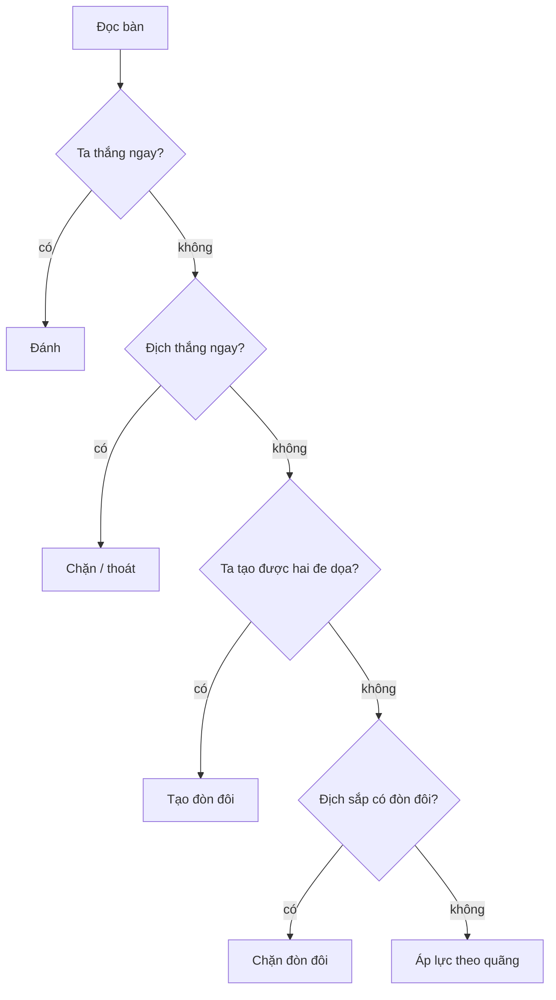

# Nguyên lý hoạt động — Áp Lực

Bot không được dạy khai cuộc. Nó được dạy một thứ tự: **cái gì kết thúc ván thì làm trước, cái gì chỉ đẹp thì làm sau, và không đổ hết vốn vào một hướng yếu.**

Thứ tự đó lấy từ một trò kéo co ngân sách, rồi ánh xạ sang cờ.

## Bài gốc

Hai người, mỗi người một ngân sách cố định (ví dụ 100). Mỗi lượt đặt một phần ngân sách để kéo về phía mình. Ai chạm đích trước thì thắng. Hòa thì bên có lợi thế hòa thắng.

Ba luật của bài đó:

| Tình huống | Nước đúng | Vì sao |
|---|---|---|
| Còn đúng một bước tới đích | Đặt đúng số cần để chạm | Giữ quân không còn nghĩa |
| Đối thủ còn đúng một bước | Đặt đủ để chặn | Không chặn là thua ngay |
| Giữa ván | Ép theo `ngân sách đối thủ / quãng còn lại`, cộng một nhịp | Bên gần đích hơn thì nước đó đáng hơn |
| Hàng còn xa | Không all-in | Vốn đã đổ không rút lại được |

Công thức giữa ván, sau khi đã chặn nước thắng ngay:

$$
\text{ép} = \min\left(\frac{B_{\text{địch}}}{d_{\text{địch}}} + 1,\; \frac{B_{\text{ta}}}{d_{\text{ta}}}\right)
$$

$B$ là ngân sách còn lại, $d$ là quãng tới đích. Số hạng $+1$ là nhịp phòng thủ. Cái `min` là trần: không được ép mạnh hơn phần vốn mình còn chia cho quãng mình còn phải đi.

## Ánh xạ sang cờ

Cờ không có ngân sách. Có **quãng tới thế kết** và **một nước mỗi lượt**.

| Bài kéo co | Caro | Tướng |
|---|---|---|
| Chạm đích | Năm quân liền | Chiếu hết |
| Đối thủ sắp chạm | Chặn năm quân | Thoát chiếu |
| Hai đường cùng chạm, đối thủ chỉ đi một | Song ba, tứ hai đầu | Ép chiếu — mọi đáp đều thua |
| Ép theo quãng | Hình gần năm hơn được điểm cao hơn | Quân nặng gần cung đối phương được cộng điểm |
| Không all-in | Không đuổi hàng yếu khi có đe dọa gần hơn | Không đổi xe lấy tốt nếu chưa thấy hết |

## Vì sao thứ tự này, không phải thứ tự khác

### 1. Thế kết tuyệt đối

Trong trò hữu hạn, xác định, thông tin đầy đủ, không có may rủi, **định lý Zermelo** nói một trong hai bên có chiến lược thắng, hoặc cả hai cùng giữ được hòa. Nước dẫn tới thế kết tốt hơn mọi nước chỉ làm hình đẹp. Nên thắng ngay đứng trên cùng.

### 2. Đối thủ chỉ có một nước

Song ba và tứ hai đầu là đòn đôi: sau nước của ta, địch phải chặn hai chỗ nhưng chỉ đi được một. Đó là lợi thế **nhịp** (tempo). Trong bài kéo co, đây là trường hợp hòa nghiêng về mình: đối thủ không đủ lượt để trả cả hai mối. Nên đòn đôi đứng ngay dưới thắng / chặn thắng.

### 3. Áp lực là xấp xỉ, không phải chứng minh

Khi chưa có thế kết, bot ước khoảng cách tới năm quân hoặc tới cung. Ước này là **tham lam theo biên**: nước nào rút ngắn quãng nhiều hơn thì đáng hơn. Nó không chứng minh nước đó thắng. Trần `min` giữ cho ước không nuốt hết vốn — trên cờ, điều đó thành "không đổi quân nặng lấy tốt".

### 4. Phòng thủ được cộng một nhịp

Hằng số phòng thủ của caro là $1{,}15$: điểm địch nhân $1{,}15$ rồi mới so với điểm ta. Một nhịp phòng thủ rẻ hơn một nhịp tấn công bị lỡ, vì lỡ chặn là thua ngay, lỡ tấn công chỉ chậm một nước.

## Hai cách thực hiện cùng một nguyên lý

Caro và tướng dùng **cùng thứ tự**, khác **cách đo quãng**.

| | Caro | Tướng |
|---|---|---|
| Đo quãng | Khớp hình trên 4 hướng: năm, tứ, ba hở, hai hở | Giá trị quân + vị trí + mái che tướng |
| Tìm nước | Lọc ứng viên cách quân đã có ≤ 2 ô | Sinh nước hợp lệ, rồi negamax |
| Tầm nhìn | Một nước, nhưng thấy đòn đôi | Hết hai nước đáp, sâu thêm ở nước chính |
| Chống all-in | Không chọn hàng yếu khi có đe dọa gần | Quiesce thấy ăn lại; không đổi xe lấy tốt |

Chi tiết công thức và định lý nằm ở [TDD](tdd.md).
