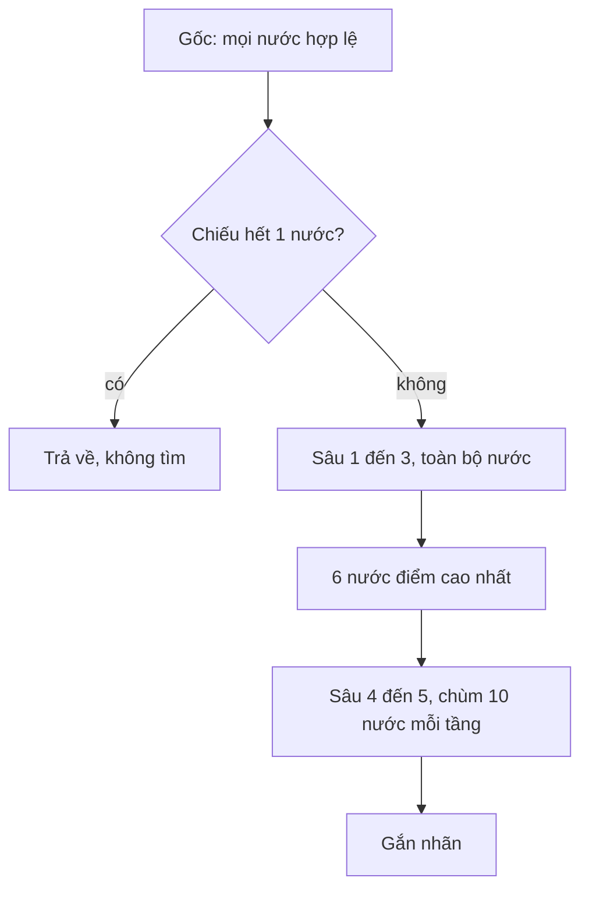

# TDD — thiết kế kỹ thuật

Phân tích thiết kế của hai bot và phần luật. Nguyên lý sản phẩm nằm ở [nguyên lý hoạt động](nguyen-ly.md). PRD nằm ở [docs/prd](prd/).

## 1. Bối cảnh toán

Hai bàn đều là trò **hữu hạn, xác định, thông tin đầy đủ, tổng bằng không, không có may rủi**.

### Định lý Zermelo (1913)

Mọi trò như vậy đều **xác định**: một trong hai bên có chiến lược thắng, hoặc cả hai có chiến lược giữ hòa.

Hệ quả thiết kế: nước dẫn tới thế kết tốt hơn mọi nước chỉ cải thiện hình. Thứ tự Áp Lực đặt thắng ngay và chặn thắng ngay lên trên áp lực.

Caro 32×32 tự do và cờ tướng đủ quân **chưa được giải**. Bot xấp xỉ giá trị của định lý, không tính ra chiến lược Zermelo.

### Định lý minimax của von Neumann

Với trò tổng bằng không hữu hạn, giá trị tồn tại và

$$
v = \max_{a \in A} \min_{b \in B} u(a, b) = \min_{b \in B} \max_{a \in A} u(a, b).
$$

Cân bằng Nash của trò tổng bằng không trùng với cặp chiến lược minimax. Trên cờ, $u$ là kết quả cuối: thắng, hòa, thua.

**Negamax** là dạng rút gọn khi hàm lợi ích phản đối xứng:

$$
v(p, s) = -\, v(p, \bar s)
$$

sau khi đã đi một nước. Tướng dùng negamax. Caro không tìm cây — nó xếp nước theo hình, nên không cần định lý này cho nước đi, chỉ cần nó để biện minh thứ tự thế kết.

### Alpha-beta (Knuth & Moore, 1975)

Cắt nhánh không đổi giá trị minimax nếu cửa sổ $(\alpha, \beta)$ được giữ đúng. Với thứ tự nước hoàn hảo, số nút giảm từ $O(b^{d})$ xuống khoảng $O(b^{d/2})$.

Tướng sắp nước: nước trong bảng thế trước, nước sát thủ, nước ăn theo giá trị quân bị ăn trừ quân đi ăn (MVV-LVA), rồi lịch sử nước tĩnh.

### Hiệu ứng chân trời (Berliner)

Tìm sâu cố định có thể thấy một nước ăn lời và không thấy nước ăn lại ngay sau tầm. **Tìm tĩnh** (quiescence) kéo thêm các nước ăn cho đến khi không còn ăn, hoặc đến trần.

Tướng tìm tĩnh sâu 2, và luôn cho phép ăn lại đúng ô vừa bị ăn (`hang`), nên chuỗi đổi quân không bị cắt giữa chừng. Đó là lý do pháo không ăn mã đầu: xe ăn lại nằm trong chuỗi tĩnh.

### Băm Zobrist

Mỗi ô và mỗi loại quân một số ngẫu nhiên. Băm thế là XOR của các quân đang có, cộng bên đi. Đi một nước thì XOR quân ra ô cũ, XOR vào ô mới, XOR quân bị ăn, XOR bên đi. $O(1)$ mỗi nước.

Bảng thế $2^{16}$ ô, khóa 32 bit. Xác suất đụng khóa khi vài chục nghìn nút là nhỏ nhưng không bằng không. Đụng thì có thể lấy điểm sai — chấp nhận để giữ tốc độ.

### Cắt nước bỏ lượt (null-move)

Quan sát thực nghiệm: bỏ lượt hiếm khi là nước tốt, trừ thế bí buộc phải đi (zugzwang). Nếu bỏ lượt mà vẫn $\ge \beta$, cắt nhánh.

$$
v \ge -\, v_{\text{null}}(d - R - 1),\quad R = 2
$$

Không dùng khi đang bị chiếu, ở gốc, hoặc sâu dưới 3. Không đệ quy null-move hai lần liền. Phép này **không đúng đắn**: có thế nó cắt nhầm. Đổi lấy tốc độ để còn ngân sách đọc sâu.

### Độ phức tạp

Khai cuộc tướng khoảng 44 nước, hệ số nhánh $b \approx 40$.

| Tầm | Nút nếu không cắt | Thực tế |
|---|---|---|
| Hết 2 nước đáp (sâu 3) | $\sim 40^{3} = 6{,}4\cdot 10^{4}$ lá, cộng sinh nước | khoảng 180–300 ms |
| Sâu 5 toàn bàn | $\sim 40^{5} \approx 10^{8}$ | không kịp |
| Sâu 5, 6 nước gốc, chùm 10 | cắt bởi alpha-beta và trần thời gian | trong 420 ms |

Trần 420 ms là ràng buộc giao diện: tìm kiếm chạy đồng bộ trên luồng vẽ. Quá một giây thì bàn khựng.

## 2. Ánh xạ công thức kéo co

Bài gốc, giữa ván:

$$
\text{ép} = \min\left(\frac{B_{\text{địch}}}{d_{\text{địch}}} + 1,\; \frac{B_{\text{ta}}}{d_{\text{ta}}}\right)
$$

### Caro

Không có $B$. Quãng $d$ đo bằng hình trên bốn hướng. Mỗi hướng lấy hình cao nhất, rồi cộng:

| Hình | Điểm | Nghĩa với $d$ |
|---|---|---|
| `MMMMM` | $10^{9}$ | $d = 0$, thế kết |
| tứ hai đầu, tứ hở | $8\cdot 10^{7}$ | $d = 1$, địch chặn không xuể nếu có hai |
| ba hở | $8\cdot 10^{5}$ | $d = 2$ |
| hai hở | $8\cdot 10^{3}$ | $d = 3$ |
| một quân có chỗ thở | $5\cdot 10^{2}$ | $d = 4$ |

Điểm áp lực:

$$
\text{điểm}(ô) = S_{\text{ta}}(ô) + 1{,}15\, S_{\text{địch}}(ô)
$$

$1{,}15$ là số $+1$ của bài gốc, viết dưới dạng hệ số vì điểm hình không cùng đơn vị với ngân sách. Hòa điểm thì lấy ô gần tâm hơn — tương tự lợi thế hòa của bài gốc.

Ứng viên chỉ là ô trống cách một quân đã có tối đa 2 ô Chebyshev, hoặc ô giữa nếu bàn trống. Mọi nước thắng ngay nằm trong tập này, vì năm quân cần bốn quân cũ trong bán kính 4, và nước lấp lỗ hoặc nối nằm trong bán kính 2 của quân đã có khi đã có bốn quân — trường hợp biên được `createsWinAt` bắt trong tập ứng viên.

Đòn đôi: sau khi đặt thử, có $\ge 2$ ô thắng, hoặc $\ge 2$ hướng ba hở. Đó là nước mà địch không đủ một lượt để trả cả hai, cùng vai với lợi thế hòa.

### Tướng

$d$ đo bằng giá trị quân và khoảng cách Manhattan tới tướng địch.

$$
V = v_{\text{quân}} + \text{PST} + \text{mái}
$$

| Quân | $v$ | Ghi chú |
|---|---|---|
| Xe | 900 | thêm 22 nếu cột không tốt, 14 nếu cùng cột tướng địch |
| Pháo | 450 | 32 nếu giữa, 10 nếu đã tiến |
| Mã | 400 | $7$ mỗi hàng đã tiến, $5$ mỗi bước gần giữa |
| Tượng, sĩ | 180 | 6 nếu còn ở hàng nhà |
| Tốt | 80 | thêm 70 khi qua sông, cộng gần cột tướng địch |
| Tướng | 0 | 10 nếu giữa cung; mái che +14 mỗi sĩ kề |

Trần chống all-in không viết thành `min` trên điểm. Nó nằm ở tìm tĩnh: ăn một quân rồi bị ăn lại quân nặng hơn thì điểm âm, nước đó thua nước tĩnh. Đổi xe (900) lấy tốt (80) rồi bị ăn lại là lỗ khoảng 820, trừ khi chuỗi dẫn tới chiếu hết — lúc đó điểm mate $10^{5}$ át giá trị quân.

## 3. Thiết kế tướng



### Sinh nước và xét chiếu

`legalMoves` sinh nước giả rồi loại nước để tướng mình bị chiếu hoặc hai tướng đối mặt.

Xét chiếu không quét 90 ô. Tướng trong cung chỉ bị đe dọa bởi xe, pháo, mã, tốt và tướng đối mặt:

- bốn tia: quân đầu là xe địch, hoặc tướng địch cùng cột; quân thứ hai là pháo địch,
- tám ô mã, kiểm tra chân,
- tốt: một ô trước, và ngang nếu tốt đã qua sông.

Sĩ và tượng không bao giờ tấn công cung đối phương, vì sĩ không ra cung và tượng không sang sông. Đây là bất biến của luật, không phải tối ưu hóa mơ hồ. Đã đối chiếu với quét đủ quân trên 2400 thế ngẫu nhiên.

### Tìm kiếm

```text
search(sâu, α, β):
  hết giờ            → hủy, gốc giữ kết quả vòng trước
  không còn tướng    → -MATE + ply
  sâu ≤ 0, không chiếu → quiesce
  có trong bảng thế  → dùng nếu sâu đủ và cờ đúng
  null-move          → cắt nếu ≥ β
  với mỗi nước đã sắp:
    đi, đệ quy -search, hoàn tác
    cập nhật α; ≥ β thì cắt
```

Giảm muộn: từ nước tĩnh thứ 5 trở đi, ở sâu ≥ 3, giảm một tầng. Có thể lỡ nước tĩnh hay. Chấp nhận.

Đọc sâu có chọn: sau vòng sâu 3 toàn bàn, lấy 6 nước điểm cao, tìm tiếp đến sâu 5 với `beam = 10`. Nước ăn vượt trần chùm vẫn được xét. Nước tĩnh ngoài chùm thì bỏ.

### Nhãn

| Điều kiện | Nhãn |
|---|---|
| Quét thấy chiếu hết một nước | Chiếu hết |
| Đang bị chiếu trước nước đi | Thoát chiếu |
| Điểm $> MATE / 2$ | Ép chiếu |
| Ô đích có quân | Ăn quân |
| Còn lại | Áp lực |

`MATE = 100000`. Điểm mate lưu trong bảng thế được cộng hoặc trừ `ply` để khoảng cách hết quân không lệch khi lấy ra ở tầng khác.

## 4. Thiết kế caro

Không có cây tìm. Một lượt:

1. Lọc ứng viên.
2. Lọc ô `createsWinAt` của ta → thắng.
3. Lọc ô thắng của địch → chặn.
4. Đặt thử từng ô, đếm ô thắng và ba hở → đòn đôi nếu ≥ 2.
5. Đặt thử cho địch → chặn đòn đôi.
6. Còn lại xếp theo $S_{\text{ta}} + 1{,}15\, S_{\text{địch}}$, hòa thì gần tâm.

Khớp hình trên cửa sổ 11 ô (`W` ngoài bàn, `.` trống, `M` ta, `O` địch). Mỗi hướng lấy hình cao nhất rồi cộng — một hướng không được tính vừa là năm vừa là tứ.

## 5. Module

| Module | Trách nhiệm | Không làm |
|---|---|---|
| `caro/rules.ts` | Bàn, lượt, thắng, hoàn tác | Không chọn nước |
| `caro/bot.ts` | Chọn ô và nhãn | Không vẽ, không lưu |
| `xiangqi/rules.ts` | Nước giả, nước hợp lệ, chiếu, lặp thế | Không điểm, không tìm |
| `xiangqi/bot.ts` | Tìm, điểm, nhãn | Không vẽ |
| `components/*` | Bàn, trạng thái, âm, tỷ số local | Không sửa luật |
| `routes/index.tsx` | Chọn bàn | Không giữ trạng thái ván |

Luật và bot tách nhau để test luật không cần bot, và để đổi tầm tìm không đụng nước hợp lệ.

## 6. Đánh đổi

| Quyết định | Được | Mất |
|---|---|---|
| Caro heuristic, không minimax | Một nước tức thì, thấy đòn đôi | Không thấy bẫy ba nước |
| Tướng sâu 3 toàn bàn + sâu 5 có chọn | Thấy ăn lại và một số hết quân dài | Nước đầu trông yếu nhưng về sau hay thì bị loại trước khi đọc sâu |
| Null-move | Sâu hơn trong 420 ms | Có thể cắt nhầm thế zugzwang |
| Khóa Zobrist 32 bit | XOR nhanh | Đụng khóa hiếm |
| Lặp ba lần = hòa | Dễ cắt ván vô hạn | Không đúng luật chiếu vĩnh viễn |
| Không sách khai cuộc | Mọi thế đều một cách nghĩ | Khai cuộc không giống sách |

## 7. Kiểm thử

| File | Khóa |
|---|---|
| `scripts/caro-bot.test.ts` | Tâm bàn, thắng có lỗ, chặn, song ba, tự đấu không bỏ thắng |
| `scripts/xiangqi.test.ts` | 44 nước, chân mã, tốt, tượng, đối mặt, chiếu hết, xe treo, không đổi pháo lấy mã, thời gian |

Chạy:

```bash
node_modules/.bin/jiti scripts/caro-bot.test.ts
node_modules/.bin/jiti scripts/xiangqi.test.ts
```

Test không thay cho chứng minh đúng đắn của alpha-beta. Chúng khóa các bất biến mà thứ tự Áp Lực yêu cầu: thế kết trước, không all-in thấy được trong tầm tìm.
